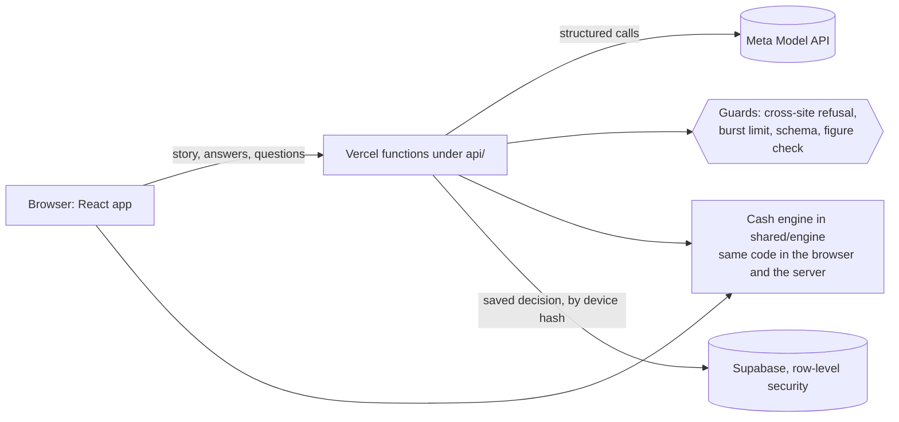

# Parallax

**For judges:** [JUDGES.md](JUDGES.md) maps each criterion to files and commands, and lists the limits. `npm run eval` needs no key.

[](https://github.com/Sibusiso-K/Parallax/actions/workflows/ci.yml)
[](https://github.com/Sibusiso-K/Parallax/actions/workflows/codeql.yml)
[](LICENSE)

**Rehearse a business decision before you bet the business on it.** A founder describes a choice in their own words
(take a big contract, hire, raise prices). Parallax reads the figures, builds three possible futures, and runs 36 months
of cash on each one. The founder can stress-test each future, ask the founder they would become on it, hold a board
meeting with all three, and print a decision memo.

**Live:** https://parallax-one-ivory.vercel.app

Parallax is a reflection aid, not financial advice. It is for people aged 18 and over.

## Two-minute review

```bash
git clone https://github.com/Sibusiso-K/Parallax.git && cd Parallax
npm ci
npm run verify        # typecheck, the offline test suite and the production build
npm run dev           # open http://localhost:5173 and press "Try the demo"
```

No keys are needed. In demo mode nothing leaves the machine. To check the **deployed** site without spending model
credits, run the post-deploy smoke test:

```bash
npm run smoke -- https://parallax-one-ivory.vercel.app
```

## Why it matters

Parallax is aimed at owners of small businesses in South Africa, where cash strain is common. Three figures, each with
its source and its limits, are set out in [docs/IMPACT.md](docs/IMPACT.md):

- **62%** of South African small businesses reported cash flow problems in the past year (Xero, January–February 2026,
  427 businesses; vendor-commissioned).
- **R12.4 billion** in government invoices, 95,399 of them older than 30 days, were unpaid at the end of Q2 2025
  (National Treasury, relayed by Business Report).
- **1,534** business liquidations in 2025, of which 1,341 were voluntary (Stats SA, relayed by EWN).

We have no user evidence yet. [docs/IMPACT.md](docs/IMPACT.md) sets out the plan for founder sessions, and it says which
figures we do not use.

## Where the Meta models are used

Every figure is computed by the cash engine in code. The models only read, plan and write words, and every reply that
could carry a figure is checked against the engine before it is shown.

| Feature | Meta model | Where to look |
| --- | --- | --- |
| Reads the founder's story into figures, each with the words it came from | Muse Spark | `shared/intake/agent.ts` |
| Checks the figures it read against the story and flags contradictions | Muse Spark | `shared/intake/check.ts` |
| The future self on each path answers in the first person | Muse Spark | `shared/chat/future-self.ts` |
| A board meeting: three futures answer, then a moderator says where they agree and differ | Muse Spark | `shared/chat/board.ts` |
| A what-if in words ("what if they pay late and I raise prices 10%?") becomes lever settings | Muse Spark | `shared/whatif/read.ts`, `api/whatif.ts` |
| A planning agent searches for plans that meet a cash goal, calling the engine as tools | Muse Spark (tool calls) | `shared/agent/planner.ts` |
| The advisor in the 3D room, checked sentence by sentence | Muse Spark | `shared/scene/advisor-model.ts`, `api/advisor.ts` |
| Dresses the 3D room for the founder's own business | Muse Spark | `shared/scene/dressing.ts`, `api/scene.ts` |
| Draws the founder's portrait for each future | Muse Image | `shared/providers/image.ts` |
| Turns speech into text ("Speak instead", and asking the room out loud) | Muse Voice Transcribe | `shared/providers/asr.ts`, `api/transcribe.ts` |

The shared client that calls Meta (timeouts, bounded retries, one repair retry for a reply that does not match its
schema, failover between models, and refusal of contributor models) is `shared/providers/meta.ts`. The guard that keeps
figures out of model replies is `shared/guard/`. The live evaluation of these features is in `evals/`, with its results
in `evals/RESULTS.md`.

## How it fits together



- `web/` is the React app: the journey (Tell, Check, Futures, Room, Ask, Decide) and the 3D courtyard.
- `api/` holds the Vercel functions. Each one answers in fixture mode when no model is connected.
- `shared/` is the logic both sides run: the engine, the paths, the guards, the Meta clients and the agents.
- The engine is deterministic: the same path always gives the same numbers, so tests can pin them.

## Quick start

You need Node.js 20 or later (CI uses 24).

```bash
npm ci
npm run dev
```

Open http://localhost:5173. The dev server serves `/api/*` from the same handlers that run on Vercel, so you do not
need the Vercel CLI. With no settings, the app runs in **demo mode**: it reads only the demo story, uses canned replies,
and makes no network calls.

### Connecting the Meta models (optional)

Copy `.env.example` to `.env.local` and fill it in. `.env.local` is ignored by git; never commit it.

| Variable | What it does |
| --- | --- |
| `META_API_KEY` | Your Meta Model API key. |
| `META_MODEL_ENABLED` | `true` switches on every model feature above. Off by default. |
| `META_VOICE_ENABLED` | `true` turns on Meta speech-to-text. Off by default. |
| `META_MODELS`, `META_ASR_MODEL`, `META_IMAGE_MODEL`, `META_API_BASE_URL` | Optional overrides. Defaults are in `shared/providers/meta.ts` and `shared/providers/image.ts`. |
| `SUPABASE_URL`, `SUPABASE_PUBLISHABLE_KEY` | Optional. Saves decisions to Supabase; without them a decision stays in the browser. |

With `META_MODEL_ENABLED` on, each full run of the demo makes a handful of model calls (reading the story, the self-check,
the three futures' answers, the board and the room's portrait). Set a spend limit on the Meta billing page as well.

To save decisions, apply `supabase/migrations/20261104120000_parallax_sessions.sql` to a project and set the two
Supabase variables. Row-level security limits each request to its own row.

## Checks

| Command | What it does | Calls a model? |
| --- | --- | --- |
| `npm run lint` | oxlint: React hook rules and correctness rules. Errors fail the build. | No |
| `npm run typecheck` | TypeScript, strict, across the app, the functions and the evaluation. | No |
| `npm test` | The offline suite. A guard blocks every network request, so a test cannot spend credits. | No |
| `npm run stress` | The randomised engine and pipeline suites. Set `STRESS_RUNS=2000` to go harder. | No |
| `npm run verify` | Lint, typecheck, tests and build, in order. CI runs the same steps. | No |
| `npm run smoke -- <url>` | Post-deploy checks against a live URL: the page, the bundle, the security headers, the health endpoint, and that paid routes refuse cross-site calls and empty requests before any model call. | No |
| `npm run eval:live` | The live evaluation of the Meta features: 13 fixed cases against the real models, each with a pass rule that does not depend on wording. | **Yes** (billed; run with the owner's agreement) |

CI (`.github/workflows/ci.yml`) runs typecheck, tests, build and a production dependency audit on every pull request and
every push to `main`. CodeQL (`.github/workflows/codeql.yml`) scans the code for security issues.

## Deployment

The app deploys to Vercel from `main`. Vercel builds with `npm run build`, serves `dist/`, and deploys each function under
`api/` (the Hobby plan allows twelve per deployment; there are eight). `vercel.json` sets the function time limit and the
security headers. `.vercelignore` keeps test files out of the function bundle.

After each deployment, run `npm run smoke -- <deployment-url>`. To roll back, promote the previous deployment in the
Vercel dashboard.

Set `META_API_KEY`, `META_MODEL_ENABLED` and the other variables above in the Vercel project's environment settings,
never in the repository.

## Security

See [SECURITY.md](SECURITY.md) for how to report a problem and the design notes behind these points:

- Server keys never reach the browser. The post-deploy smoke test checks the bundle for them.
- Paid routes refuse calls from other sites and apply a per-visitor burst limit.
- Saved decisions are private to one browser: the server stores only a hash of the device code.
- Model replies are checked before they are shown, and a reply that does not match its schema is never shown raw.

## Repository layout

```
api/            Vercel functions (intake, chat, advisor, scene, transcribe, whatif, session, health)
shared/         logic both sides run: engine, paths, intake, chat, agent, scene, guards, Meta clients, tests
web/            the React app (Vite): screens, the 3D courtyard, the reel and the room's advisor
evals/          the live evaluation of the Meta features, and its results
scripts/        post-deploy smoke test
supabase/       database migration for saved decisions
assets/         the 3D courtyard source and its credits (see assets/CREDITS.md)
docs/           the impact note with sources, and notes on the scene and immersive room
.github/        CI, CodeQL, Dependabot, issue and pull request templates, code owners
```

## Built during the Meta Global AI Developer Hackathon

Everything in this repository was built during the hackathon. The first commit (20 Oct, `f4d3239`) holds only a
`.gitignore`. Product work begins on 29 Oct. To see the timeline, run:

```bash
git log --reverse --format='%h %ad %s' --date=short
```

Team Sonar: Sibusiso (`Sibusiso-K`) wrote the cash engine, the intake and chat routes, the UI flow, and the
self-check, what-ifs, board meeting, languages, planning agent and the Meta panel. Lethabo (`LethaboMH14`) wrote
the 3D room and the photo world: walk mode, the room's advisor, the talking person, the board of agents, the world builder, the contract reader, the film, the reel and the PNG. The commit history
shows each change.

## Known limits

- The simulation defaults in `shared/defaults/za.json` are dated estimates, not business benchmarks. Official wage and VAT references are recorded separately and are not used as business costs or tax calculations.
- There are no accounts. A saved decision belongs to one browser's private code.
- Without a Meta key the chat, the board, the planner and the room's advisor use scripted or in-code answers, and the app says so.
- Replies in isiZulu, isiXhosa, Afrikaans, Sesotho and Setswana have not yet been reviewed by speakers of each language.
  The screens are in English only.
- A model call takes about 15 seconds for a story and about 30 seconds for a full board meeting.
- What-ifs on the futures screen are a preview: they do not change the saved numbers.
- The characters behind `?people` are drafts, not photoreal.
- The reel has no sound: the browser's speech voices cannot be recorded.
- The reel and read-aloud were checked only in Chromium-based browsers. Safari, Android voices and real phones are not yet checked.
- Limits count by network address, so visitors who share one connection share the limit.
- In development builds, React reports duplicate-key warnings on first load. The page renders complete; the source is not yet isolated.
- The draft characters use one CC BY garment, the advisor's overshirt (CC BY 4.0). Its credit is in `assets/CREDITS.md`
  and in the room's caption, which shows whenever the characters do (`?people`).

## Contributing and license

Contributions follow [CONTRIBUTING.md](CONTRIBUTING.md). This project is released under the [MIT license](LICENSE).
