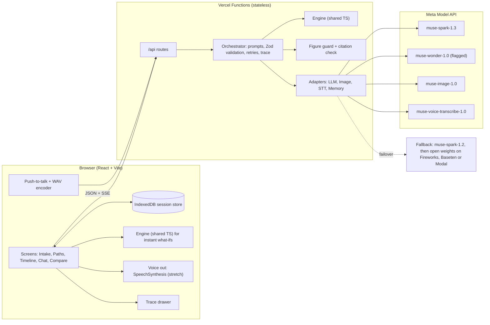
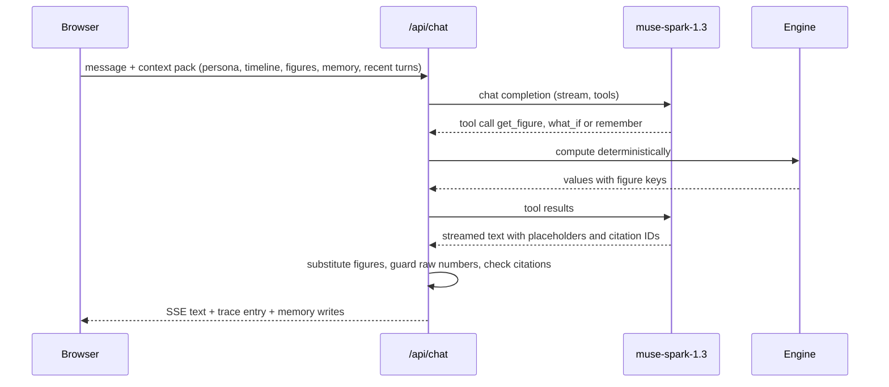

# Parallax: Architecture

Technical design for the 10-day build (26 Oct – 4 Nov 2026). Written 20 Oct 2026. `docs/CONTEXT.md` remains the source of truth for event facts; this doc covers how we build.

Labels: **verified** = read on the vendor's own docs on 20 Oct 2026 (see [Sources](#sources)); **reported** = secondary source; **unverified** = not found, designed around with an adapter.

---

## 1. Design principles

1. **The model proposes, code computes.** The model suggests paths, assumption ranges and events. Every money figure the user sees is computed in code from stated assumptions (the CivicLens rule: no model writes figures).
2. **Everything is traceable.** Assumptions and events carry stable IDs (`A7`, `E12`). Avatar answers cite them, and every model call writes a trace entry.
3. **One adapter per capability** (LLM, image, speech-to-text, TTS, memory), so a provider can be swapped by config.
4. **The session lives in the browser.** The server is stateless: nothing to leak or forget to delete.
5. **Boring infrastructure.** One Vite app, Vercel Functions and Server-Sent Events (SSE). No database, WebSocket server or queue.

## 2. Meta Model API: what we verified

| Topic | Fact | Status |
|---|---|---|
| Base URL, auth | `https://api.meta.ai/v1`, `Authorization: Bearer <key>` (docs use `MODEL_API_KEY`). Keys belong to a team, which shares rate limits. Keep keys server-side [1][4] | verified |
| Protocols | Responses, Chat Completions ("OpenAI-compatible"), Messages (Anthropic-compatible). Use the `openai` npm package with `baseURL` and pass the key explicitly [1][5] | verified |
| Model IDs | `muse-spark-1.3` ("recommended for new work"), `muse-spark-1.2` (previous version, our first fallback), `muse-wonder-1.0` (Preview), `muse-image-1.0`, `muse-voice-transcribe-1.0`. Spark and Wonder: 1,048,576-token context, tools, structured output [2] | verified |
| Structured output | `response_format: { type: "json_schema", json_schema: { name, schema, strict } }`, decoding constrained to the schema. No recursive schemas; max depth 10 [6] | verified |
| Tool calling | Parallel calls, streamed arguments. `tool_choice` supports only `"auto"`, so handle both tool calls and plain text [7] | verified |
| Reasoning | `reasoning_effort` (`minimal` … `max`); Spark always reasons. Reasoning tokens are billed as output [8][10] | verified |
| State | Chat Completions "has no built-in memory between requests"; Responses stores state by default (`store: true`) [10][11] | verified |
| Active Memory (Muse Wonder) | Meta describes it as carrying "what matters to you across conversations" [21], but the developer docs show no parameter, tool or endpoint for it [2][11][15]. Reviewer re-checked the models page on 20 Oct: still absent | **not available** to developers (as documented) |
| Images | `/v1/images/generations` and `/v1/images/edits` (1–10 reference images); `size` sets aspect ratio; **no `seed`**; blocked prompts return `content_policy_violation` [12] | verified |
| Speech-to-text | `POST /v1/asr/transcribe`: WAV mono PCM16 at 16/24 kHz, ≤ 10 min, < 32 MB. The realtime WebSocket needs the key in its first frame. 25 supported languages with code-switching; isiZulu and Afrikaans are not among them [13] | verified |
| Text-to-speech | None listed; docs say Voice Transcribe "does not synthesize speech" [1] | verified: **no Meta TTS** |
| Prices | Spark (standard) USD 1.25 in / 0.15 cached / 4.25 out per 1M tokens; Wonder 4 / 0.20 / 20; Muse Image USD 0.01 per image; Voice Transcribe USD 0.18 per audio hour [3] | verified |
| Rate limits | Per team: Spark and Wonder 3,000 RPM / 4M TPM; Muse Image 150 RPM; Voice Transcribe 256 concurrent streams [3] | verified |
| Contributor mode | `-contributor` model IDs are much cheaper, but you allow Meta to train on your prompts, files and responses [3] | verified |
| Errors | Retry 429/500/503 with exponential backoff and jitter, honouring `Retry-After`. Do not retry 400/401/402/403/404/413. A 504 means use streaming or less work per call [14] | verified |
| Region | South Africa is not on the restricted list, but access applies "only in jurisdictions where Meta has enabled access" [19][20] | verified, but **smoke-test from SA** |
| Data retention / training (standard mode) | Not stated on the pages we read; they point to the AI Developer Legal Center. Zero Data Retention exists only for qualified organisations via sales [17][18] | **unverified** |
| Hackathon credits | USD 150 per participant (CONTEXT.md). Whether they cover Wonder, Image and Voice is unknown | reported |

## 3. Stack

| Layer | Choice | Why |
|---|---|---|
| Frontend | React + TypeScript + Vite, Zustand for state, Recharts for fan charts | Sibusiso's stack; fast to build |
| Backend | Vercel Functions (Node, TypeScript) in `/api`, streaming over SSE | Deploys with the frontend. The Hobby plan allows 300 s per call and a 4.5 MB body, which is enough for our payloads [24] |
| AI client | `openai` npm SDK pointed at Meta. Zod schemas converted to JSON Schema for `response_format` | One client works for Meta and for OpenAI-compatible open-weights hosts |
| Engine | Pure TypeScript module in `/shared`, tested with Vitest | Runs on the server and in the browser (instant what-if sliders) |
| Session storage | Browser IndexedDB (`idb-keyval`) | No database; deleting a session is local and complete |
| Abuse guard (optional) | Upstash Redis for per-IP counters only (no user content), plus a demo passcode | Protects the credits on a public URL |

**Why not WebSocket:** SSE over `fetch` covers token streaming, and Vercel's WebSocket support is still public beta [24]. Realtime transcription would need a server relay to keep the key secret, so the MVP uses push-to-talk with file transcription.

**Why Chat Completions, not Responses:** fallback hosts speak it, and it keeps no state at Meta. We lose reasoning carry-over between turns [10], which short avatar replies don't need.

```
/web      React app (screens, IndexedDB store, WAV encoder, trace drawer)
/api      intake.ts  paths.ts  simulate.ts  persona.ts  image.ts  chat.ts  transcribe.ts  compare.ts
/shared   types.ts  schemas.ts (Zod)  engine/  prompts/  providers/  defaults/za.json
```

## 4. Components



## 5. Request flow

| # | Step | Route and model | Model output (structured) | Code does | User checkpoint |
|---|---|---|---|---|---|
| 1 | Intake | `/api/intake`, Spark, low effort | Draft `Profile`, `missing[]`, `ambiguous[]` | Parses amounts from form fields; validates | Confirms profile; at most 3 follow-ups |
| 2 | Path definition | `/api/paths`, Spark | 2–3 `Path`s with `Assumption` ranges and rationale | Fills gaps from `defaults/za.json` (sourced, dated); checks low ≤ base ≤ high | Edits or accepts assumptions |
| 3 | Simulation | `/api/simulate`, Spark (Wonder behind a flag), one call per path in parallel | `TimelineEvent`s whose effects **reference assumption IDs**, never amounts | Low / base / high runs (Monte Carlo is stretch), figures, milestones, sensitivity | Sees timeline and range chart |
| 4 | Persona | `/api/persona`, Spark | `PersonaCard` grounded in event IDs | Checks that every cited ID exists | — |
| 5 | Avatar image | `/api/image`, Muse Image | Base portrait, then one edit per path | Builds prompts from a fixed style plus the persona card | Picks look attributes (no photo) |
| 6 | Conversation | `/api/chat` (SSE), Spark, tools | Text containing figure placeholders and citation IDs; tool calls | Substitutes figures, guards numbers, checks citations, writes memory | Talks, switches paths, adjusts what-ifs |
| 7 | Compare | `/api/compare`, Spark | Side-by-side narrative with placeholders | Comparison table and sensitivity ranking | Pins "what matters to me" |
| 8 | Decision summary | `/api/compare?mode=summary`, Spark | Reflection: trade-offs, open questions, next steps to check | Same figure substitution; "not financial advice" footer | Exports or deletes |

One avatar turn:



## 6. Data model

```ts
type Range = { low: number; base: number; high: number };

interface Profile {
  ageBand: string; province?: string; netMonthlyIncome: number; monthlyExpenses: number;
  savings: number; debts: { label: string; balance: number; ratePct: number; payment: number }[];
  dependants: number; skills: string[]; riskTolerance: 'low' | 'medium' | 'high';
  goals: string[]; constraints: string[];
  fieldSource: Record<string, 'user' | 'extracted-confirmed' | 'default'>;
}
interface Assumption {
  id: string; pathId: string | 'shared'; label: string;
  unit: 'ZAR/month' | 'ZAR' | '%/year' | 'probability/year' | 'months';
  range: Range; source: 'user' | 'default-table' | 'model-suggested';
  rationale: string; editedByUser: boolean;
}
interface Path { id: 'A' | 'B' | 'C'; title: string; summary: string; horizonMonths: number; assumptionIds: string[] }
interface TimelineEvent {
  id: string; pathId: string; month: number; kind: 'milestone' | 'setback' | 'life' | 'money';
  title: string; narrative: string; probability: number;            // 1 = part of the base story
  effects: { kind: 'set_income' | 'pause_income' | 'add_expense' | 'one_off_cost' | 'one_off_income';
             assumptionId: string; durationMonths?: number }[];
}
interface Projection {
  pathId: string; version: number; seed: number; runs: number; assumptionsHash: string;
  series: Record<'cash' | 'netWorth' | 'debt' | 'income', { month: number; p10: number; p50: number; p90: number }[]>;
  figures: Record<string, number>;                                  // "B.netWorth.y3.p50" -> 412000
  derivedMilestones: { label: string; month: number | null; percentile: 'p10' | 'p50' | 'p90' }[];
  sensitivity: { assumptionId: string; swing: number }[];           // tornado ranking
}
interface AvatarState {
  pathId: string; persona: PersonaCard; imageBase?: string; image?: string; voiceName?: string;
  memory: MemoryNote[]; rollingSummary: string;
}
interface PersonaCard { name: string; yearsAhead: number; mood: string; speakingStyle: string;
  proudOf: string[]; regrets: string[]; neverSay: string[]; groundedIn: string[] }   // event IDs
interface MemoryNote { id: string; scope: 'session' | 'avatar'; text: string; fromTurnId: string }
interface Conversation { pathId: string; turns: Turn[] }
interface Turn { id: string; role: 'user' | 'avatar'; text: string; cites: string[];
  projectionVersion: number; traceId: string; via: 'text' | 'voice' }
interface TraceEntry { id: string; ts: string; step: string; provider: string; model: string;
  latencyMs: number; tokens: { in: number; cached: number; out: number; reasoning: number };
  estCostUsd: number; inputs: string[]; outputs: string[];
  checks: { name: string; ok: boolean; detail?: string }[]; fallback?: string }
```

## 7. Simulation engine

| The model does | Code does |
|---|---|
| Proposes paths and assumption **ranges**, each with a rationale and a `model-suggested` tag | Validates ranges and prefers user values, then `defaults/za.json` (every default carries a source and date), then model suggestions |
| Writes events: when, what, how it feels, the probability, and which assumption drives the money effect | Applies the effects month by month to cash, debt, savings and income |
| Writes narrative and daily-life texture | Computes every figure, percentile, milestone date and sensitivity |

- **Mechanics:** monthly steps over a 36-month horizon (SCOPE.md §3; `horizonMonths` keeps 60 possible if we change our minds). Inputs are take-home pay and expenses (no tax engine in the MVP). Debt amortises at the stated rate, savings earn an assumed return, and expenses inflate within an assumed CPI range.
- **Setbacks:** 1 or 2 per path, chosen from the fixed library in SCOPE.md §3 (lost client, car breakdown, income gap, family emergency, rent increase). The model picks which fit the path and narrates them; code applies their money effect as stress tests.
- **Uncertainty (MVP):** three deterministic runs per path: every assumption at its unfavourable end (for a cost that is its high value), at its base value, and at its favourable end. Shown as a band labelled "bad case / likely / good case". Same inputs always give the same figures. In the data model these runs fill the `p10`, `p50` and `p90` slots, so nothing else changes if we upgrade; the UI must not call them percentiles, because all-bad and all-good together are more extreme than a true P10 or P90.
- **Uncertainty (stretch, SCOPE.md §4 item 5):** 1,000 Monte Carlo runs with a stored seed, so results reproduce. Uncertain assumptions are sampled from a triangular distribution (low, base, high), and setback events fire with their stated probability. Output is true P10/P50/P90 per month, shown as a fan chart.
- **Sensitivity:** swing each assumption to its low and high and rank by the effect on P50 net worth. "What matters most on this path" becomes a computed fact.
- **Derived milestones** are computed, not narrated: for example "emergency fund reaches 3 months" or "savings hit zero" (with P10 timing).
- **Figure keys** follow `<path>.<metric>.<y1..y3|mN>.<p10|p50|p90>` (`y4`, `y5` only if the horizon grows). The model only sees keys.
- A full run takes milliseconds, so what-if sliders recompute in the browser.

## 8. Keeping each future self in character

**Context pack**, rebuilt for every turn in a fixed order (the stable prefix comes first so automatic prompt caching can hit [9]):

1. System rules: you are this person's future self on path X; speak from experience, never give instructions or product advice; cite IDs; never write money figures, use placeholders or `get_figure`.
2. Persona card.
3. Timeline events for this path only.
4. Figures table: key yearly P10/P50/P90 values, given by key.
5. Session facts shared by all avatars (user corrections, for example "my mother lives with me now").
6. This avatar's memory notes.
7. Rolling summary of older turns (refreshed every 10 turns by a small Spark call).
8. The last 8 turns, then the new message.

**Memory.** The avatar has a `remember(note, scope)` tool. Notes go to IndexedDB, each linked to its source turn, and the user can see and delete them in the trace drawer. They sit behind a `MemoryStore` interface (`LocalMemoryStore`). Developer access to Muse Wonder's Active Memory is **unverified**, so we don't depend on it; if Meta documents it, a `WonderMemoryStore` can slot in behind the same interface. Special-category details (health, religion and the like) are filtered out before saving.

**Numbers.** The avatar writes placeholders such as `{{fig:B.netWorth.y3.p50}}`, which the server replaces with values formatted as ZAR (`Intl.NumberFormat('en-ZA', …)`). For other figures it calls `get_figure(key)`. For "what if I saved R2,000 more?" it calls `what_if(assumptionId, value)`: the engine recomputes, and the user confirms before the assumption changes. (`what_if` from chat is stretch item 2 in SCOPE.md §4; in the MVP the user edits assumptions in the assumptions panel, which re-runs the path.) The server streams the reply sentence by sentence, and a **figure guard** checks each sentence before release for currency amounts, percentages and numbers of 1,000 or more (years excluded). Any value not in the figures table or the user's own inputs is replaced with "(see chart)" and logged in the trace.

**Grounding checks.** Cited `A…`/`E…` IDs must exist on this path; unknown IDs are dropped and logged. A scripted 30-turn drift test ("what do you earn?", "did you ever lose your job?") runs against the fixture persona every evening.

## 9. Avatar images

- **No photo upload in the MVP.** The user picks a few look attributes (age band, skin tone, hair, glasses, style) or skips. Code joins them into one **base description** plus a fixed **art style** (stylised illustration, never photo-real).
- **Consistency:** generate one base portrait, then call `/v1/images/edits` once per path, with the base image as reference and a variation prompt built from the persona card (years older, setting, clothing, mood). The docs say an edit "changes only what you ask for" [12], but there is no seed, so face consistency across paths is **unverified**: test it early.
- **Failures:** on `content_policy_violation` or a 5xx, retry with a simpler prompt, then fall back to an illustrated initials badge in the path's colour.
- Images (`b64_json` WebP) are stored in IndexedDB only. The `user` field gets a random per-session hash, never an email.
- **If photos are ever added:** explicit opt-in, a plain statement that the photo goes to Meta and is never stored by us, and a delete option.

## 10. Voice

- **In:** push-to-talk, at most 60 s per clip. The browser resamples to 16 kHz mono PCM16 WAV (about 1.9 MB, under Vercel's 4.5 MB limit). `/api/transcribe` forwards it to `POST /v1/asr/transcribe`. The transcript appears in the input box for the user to correct before sending. Accuracy on South African English accents is **unverified**: test on day one. isiZulu and Afrikaans are not on the published language list.
- **Out (stretch, SCOPE.md §4 item 3; first to go in PLAN.md's cut list):** Meta offers no TTS, so in the MVP avatar replies are text. Options if we add it:

| Option | Pros | Cons |
|---|---|---|
| Browser `SpeechSynthesis` (**default if we add voice out**) | Free, no extra vendor, can give each path a different voice | Quality varies by OS; some browser voices are cloud-based |
| Meta MMS-TTS (open weights) [26] | Meta model | CC-BY-NC 4.0 (non-commercial), needs hosting |
| Third-party TTS API | Best quality | Cost, not Meta, another processor under POPIA |

Captions are always shown.

## 11. Traceability

- Every avatar reply shows "Based on" chips (for example "A3 salary growth 6–9%", "E7 retrenchment risk, 30% a year"). Tapping a chip opens the assumption or event with its source tag.
- Each turn records the projection version it used, so the history stays accurate after a what-if.
- An append-only **trace log** per session records each step's provider, model, latency, tokens, estimated cost, input and output IDs, check results and any fallback used. It is visible in a "Why?" drawer, exportable as JSON, and kept in the browser. Server logs hold metadata only.

## 12. Faulty input, timeouts, retries, fallbacks

| Situation | Handling |
|---|---|
| Vague input ("I want to change careers") | Intake asks for four must-have numbers, where "rough is fine" and "don't know" are both accepted. "Don't know" becomes a wide default-table assumption, visibly flagged |
| Contradictions (expenses far above income, no debt) | Ask once; never silently "fix" |
| Off-scope decision (medical, legal, relationships) | Explain the MVP scope and offer a career or money framing if one fits |
| Signs of distress | Pause the simulation; show the support card with local helplines (hard-coded; numbers and sources in RISKS.md §2, verified 20 Oct 2026, re-check on day 9) |
| Text that tries to instruct the model | Wrapped as quoted data; tools cannot change assumptions without a UI confirmation |
| 429 / 500 | Exponential backoff with 0–1 s jitter, honour `Retry-After`, at most 3 tries [14] |
| 503 `service_overloaded` (`Retry-After` 60 s) | One quick retry, then fail over (too slow for a live conversation) |
| Slow or 504 | Client timeouts: chat first token 20 s, simulate 90 s, image 45 s. Retry once with streaming, then fall back |
| Schema mismatch (possible on fallback hosts) | Zod validation, one repair retry that includes the errors, then defaults with a banner |
| 402 / 403 (probably billing or permission) | No retry; switch to **demo fixture mode** |
| Failover chain | `muse-spark-1.3` → `muse-spark-1.2` (same API) → open weights → fixture. Fireworks' serverless Muse Spark Open is a preview only "through October 29, 2026" [22], and serverless Muse Glimmer has ended [23]. A late fallback therefore needs an on-demand deployment, for example Glimmer 30B on Modal or Baseten via vLLM (a 4-bit build fits under 24 GB of VRAM [16]). Decide by day 3 whether it is worth it |
| Live demo insurance | Fixture mode replays a pre-computed session (fictional persona) with no API calls |

## 13. Privacy and POPIA

- **Session-scoped by default:** all user data lives in IndexedDB. The server keeps nothing (voice audio is forwarded to Meta and never written to disk); logs hold IDs and metrics only, kept for at most 30 days. Proposal, not yet agreed: the browser store clears itself 24 hours after the last activity unless the user chooses to keep the session. RISKS.md §3 holds the single agreed statement of where data lives.
- **Delete button** clears the profile, paths, conversations, images, memory and trace, and cancels in-flight requests. **Export** gives the user their data as JSON.
- **No training on user data:** a config guard refuses `-contributor` model IDs in production. We leave `prompt_cache_retention` at its default, and if we ever use Responses we set `store: false`. Meta's standard-mode retention terms are **unverified**: read the AI Developer Legal Center before launch and quote it in the privacy notice.
- **POPIA:** a plain-language consent screen up front: what we collect, why, that Meta's API processes it outside South Africa (a cross-border transfer), and how to delete it. Minimality: no names, ID numbers, employers or addresses; rough figures are fine. Users must be 18 or older. Special personal information (such as health) is not requested and is filtered from memory.
- **Not financial advice:** shown on every summary. Avatars describe experience and never recommend products (mindful of FAIS, South Africa's financial advisory law).

## 14. Cost and rate budget (estimates)

Assumptions for one full session: 3 paths, 30 avatar turns, 3 minutes of voice, 6 images (including retries), all on standard `muse-spark-1.3`.

| Step | Calls | Input tokens | Output tokens (incl. reasoning) |
|---|---|---|---|
| Intake + follow-ups | 2 | 6k | 3k |
| Paths and assumptions | 1 | 5k | 4k |
| Timeline events | 3 | 18k | 12k |
| Persona cards | 3 | 12k | 4.5k |
| Avatar turns | 30 | 300k (about 60% cached) | 30k |
| Rolling summaries | 3 | 15k | 3k |
| Compare + summary | 2 | 30k | 6k |
| **Total** | **44** | **≈ 386k** | **≈ 62.5k** |

- **Text:** input ≈ USD 0.29, output ≈ USD 0.27. **Images:** USD 0.06. **Voice:** about USD 0.01. Adding 30% for retries and repairs gives **≈ USD 0.80 per session**. Using Muse Wonder for the simulation step adds ≈ USD 0.24 (≈ USD 1.05).
- **Credits:** USD 300 (2 × 150, reported). Reserving about USD 120 for development leaves about USD 180: **roughly 170–220 full sessions**, or 60–75 if our estimates are 3× too low. Credits, not rate limits, are the constraint: a session peaks at about 3 parallel calls against a 3,000 RPM limit.
- **Savers:** prefix caching, low reasoning effort for chat, fixtures during UI work, `-contributor` models for synthetic-only evals (never real user data), and a cap of 60 avatar turns per session.

## 15. Build order (dependencies first)

1. **Day-1 smoke test** (kickoff evening, 26 Oct; earlier only if the Official Rules allow it and keys exist, see PLAN.md §2) with real keys from South Africa: each model ID, structured output, a tool call, one image, one transcription; confirm which team holds the credits.
2. `/shared` types, Zod schemas and the engine with unit tests, plus one fixture profile. No AI needed.
3. Provider adapter: Meta chat client, retry, trace, model routing by config.
4. `/api/paths` and `/api/simulate`, then the intake → assumptions editor → timeline and fan chart screens.
5. Persona and `/api/chat` with SSE, placeholders, figure guard, citations and memory.
6. Avatar images.
7. Compare and decision summary.
8. Voice in, then (stretch only) browser voice out.
9. Hardening: failover, fixture mode, passcode and rate limit, consent screen, delete and export, drift test.

## 16. Open questions for Lethabo

1. Which half do you want to own: screens, images and voice, or engine, API and prompts?
2. Are you comfortable with TypeScript, React and Vercel, or do you prefer other tools?
3. Is your Meta Model API account in the same team as Sibusiso's? Rate limits (and possibly credits) are per team.
4. Are browser voices good enough for the demo, or is a better TTS worth the cost and the privacy trade-off?
5. Should avatars speak with a South African flavour or code-switch? Spoken isiZulu and Afrikaans aren't on Muse Voice Transcribe's language list.
6. Should the default horizon be 3 or 5 years? (All docs now use 36 months; change it only with a reason.)
7. Which art style for the avatars?
8. Who sources and dates the South African defaults (CPI range, savings and debt rates, typical salary bands)?

## Sources

All read on 20 Oct 2026. `ai.developer.meta.com/docs` redirects to `dev.meta.ai/docs`.

1. Meta Model API docs overview: https://dev.meta.ai/docs/
2. Models: https://dev.meta.ai/docs/models
3. Pricing and rate limits: https://dev.meta.ai/docs/pricing-rate-limits
4. Authentication: https://dev.meta.ai/docs/authentication
5. SDKs: https://dev.meta.ai/docs/sdks
6. Structured output: https://dev.meta.ai/docs/structured-output
7. Tool calling: https://dev.meta.ai/docs/tool-calling
8. Reasoning: https://dev.meta.ai/docs/reasoning
9. Prompt caching: https://dev.meta.ai/docs/prompt-caching
10. Chat Completions protocol: https://dev.meta.ai/docs/protocols/chat-completions
11. Responses protocol: https://dev.meta.ai/docs/protocols/responses
12. Image generation: https://dev.meta.ai/docs/image-generation
13. Speech-to-text: https://dev.meta.ai/docs/speech-to-text
14. Error handling: https://dev.meta.ai/docs/error-handling
15. Agent patterns cookbook (no memory feature described): https://dev.meta.ai/docs/cookbook/agent-patterns
16. Open-weight models: https://dev.meta.ai/docs/open-weight-models, https://dev.meta.ai/docs/muse-spark-open/get-the-model, https://dev.meta.ai/docs/muse-glimmer/get-the-model
17. Data handling (help): https://dev.meta.ai/help/policies-and-privacy/data-handling
18. Zero Data Retention (help): https://dev.meta.ai/help/policies-and-privacy/zero-data-retention
19. Supported countries (help): https://dev.meta.ai/help/accounts-and-login/supported-countries
20. Geographic use policy: https://dev.meta.ai/legal/geographic-use-policy
21. Meta newsroom, Introducing Muse Wonder (12 Oct 2026): https://about.fb.com/news/2026/10/introducing-muse-wonder-models/
22. Fireworks, Muse Spark Open: https://fireworks.ai/models/fireworks/muse-spark-open
23. Fireworks, Muse Glimmer 30B: https://fireworks.ai/models/fireworks/muse-glimmer-30b
24. Vercel Functions limits: https://vercel.com/docs/functions/limitations
25. LiteLLM Meta provider (secondary, corroborates base URL and features): https://docs.litellm.ai/docs/providers/meta
26. Meta MMS-TTS model card: https://huggingface.co/facebook/mms-tts
